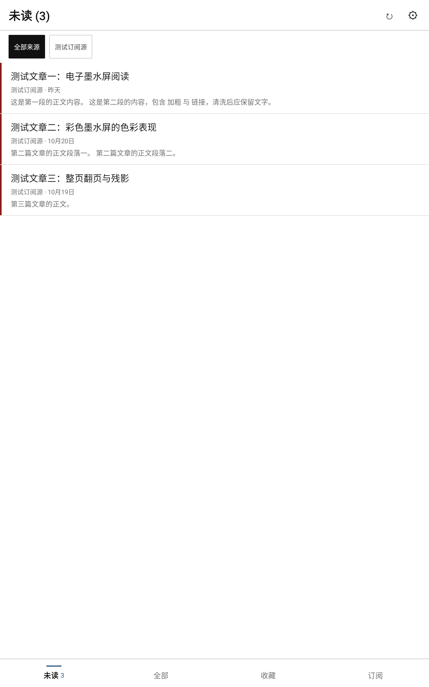
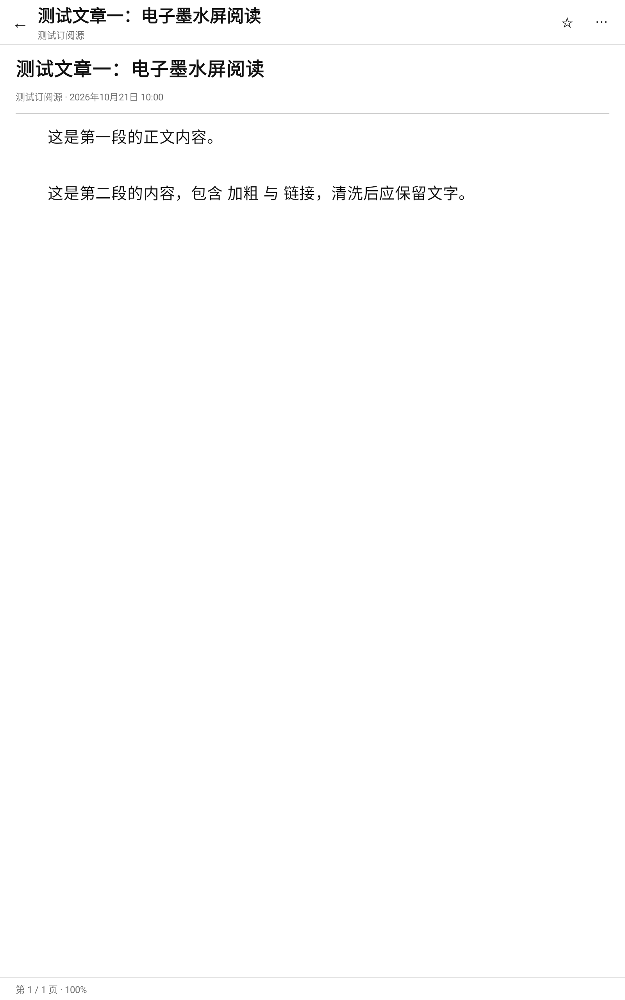
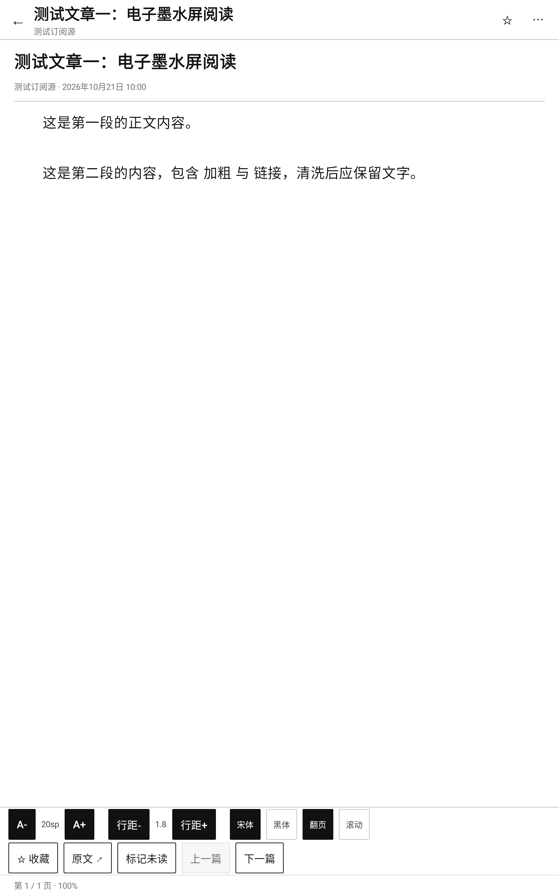
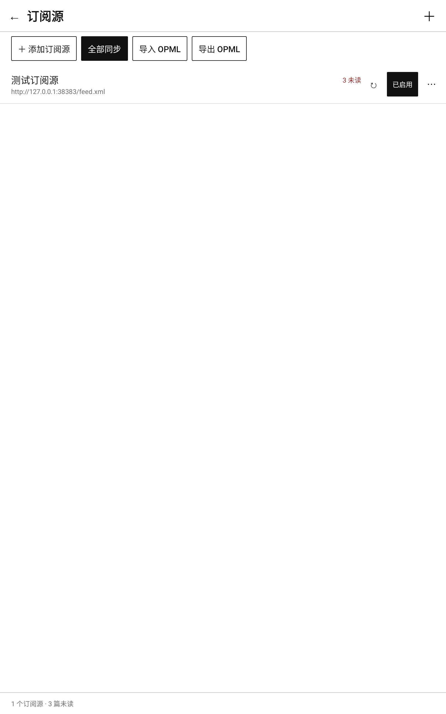
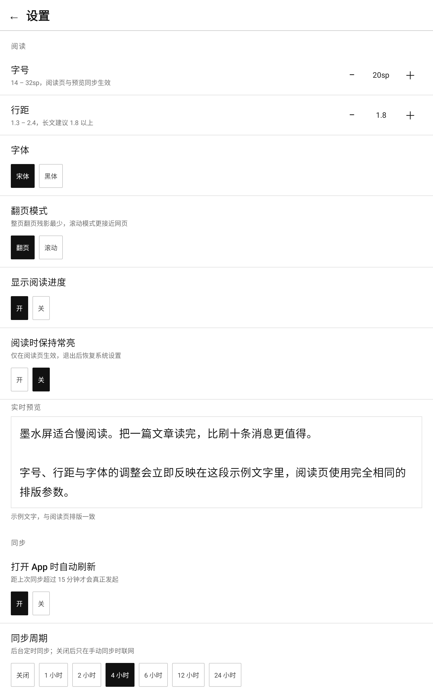
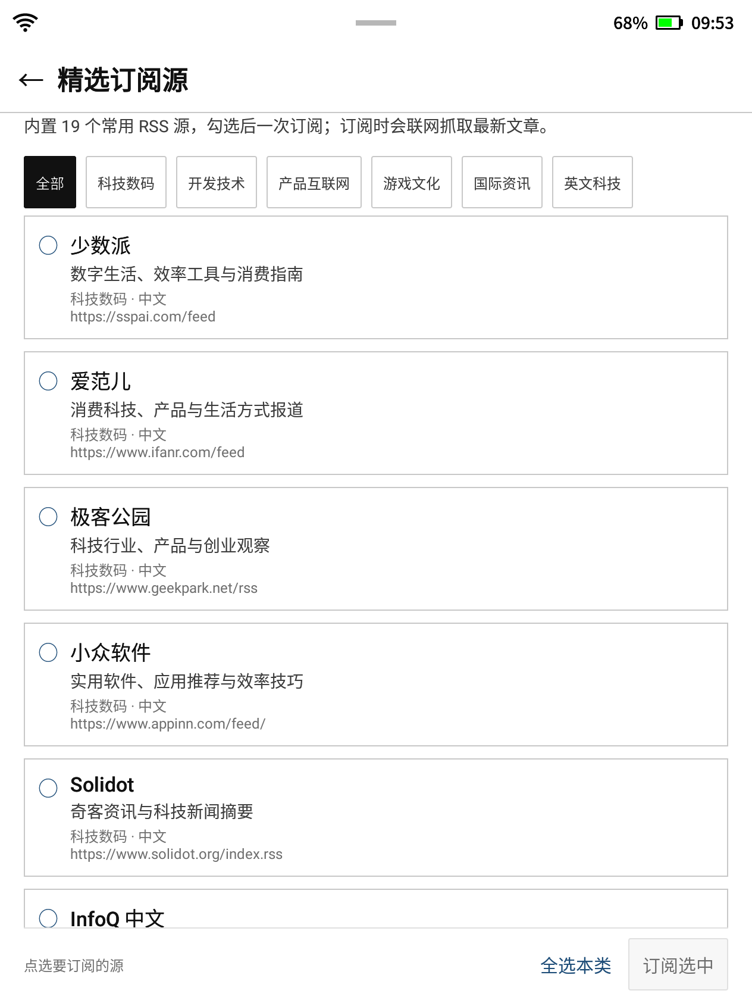
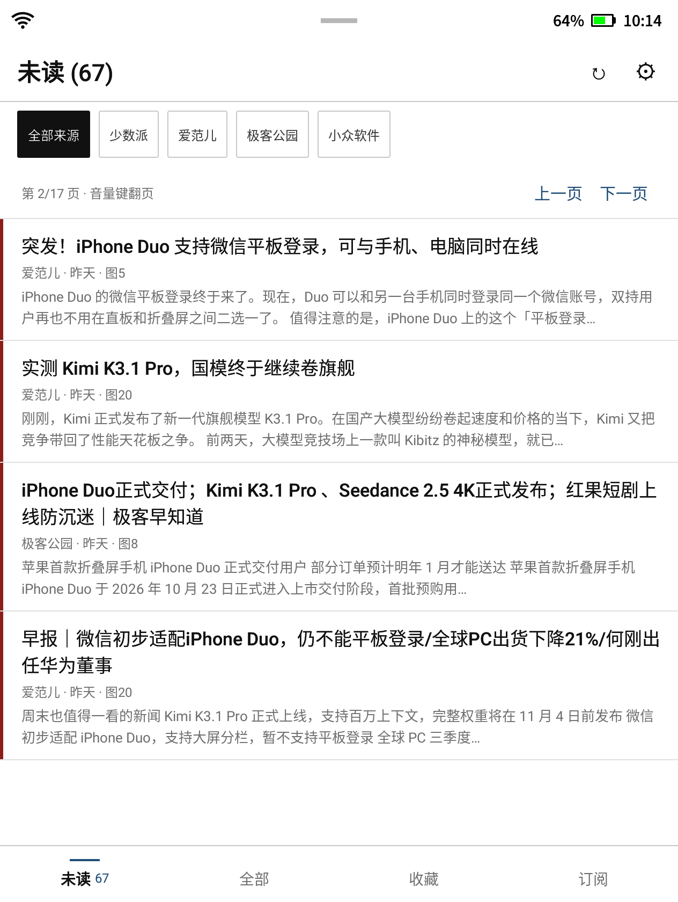
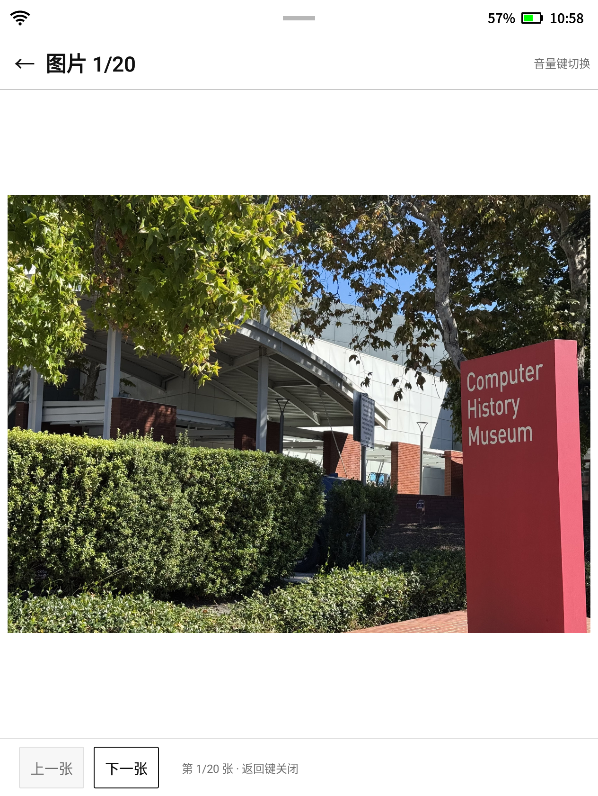
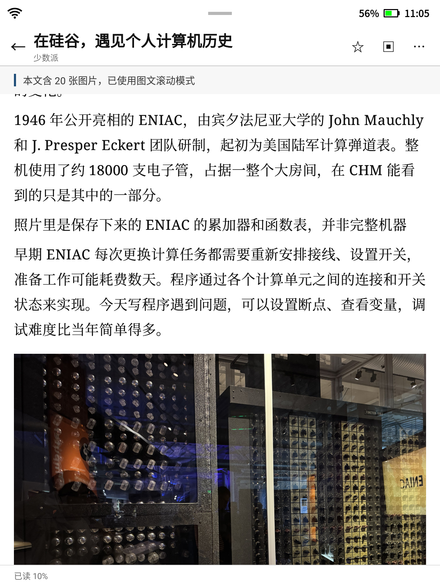

# 墨读 InkRead

[](https://github.com/xzl01/inkread/actions/workflows/android.yml)

> 为**彩色电子墨水屏 Android 阅读器**打造的 RSS 订阅阅读器。
> 零动画、高对比、整页翻页、离线可读 —— 把 RSS 阅读做成纸书体验。

- 包名：`com.inkread.reader` ｜ 版本：`0.5.1` ｜ 最低系统：Android 8.0 (API 26)
- 技术栈：Kotlin + Jetpack Compose（手写墨水屏组件）+ SQLite + OkHttp + WorkManager
- 无 Google 服务依赖（国产墨水屏设备可直接安装）
- 源码仓库：<https://github.com/xzl01/inkread>

---

## 界面预览

> 以下截图由 Robolectric 在 JVM 上真实渲染本项目 UI 得到（含真实 Compose 布局、真实 SQLite 数据层与 Mock RSS 源），不是设计稿。

| 文章列表 | 阅读页 | 阅读操作栏 |
|---|---|---|
|  |  |  |

| 订阅管理 | 设置 | 添加订阅 |
|---|---|---|
|  |  |  |

| 精选订阅源（可多选一次订阅） |
|---|
|  |

| 主页按键翻页 | 文章配图查看 | 正文图文混排 |
|---|---|---|
|  |  |  |

## 为什么单独做一个 RSS 阅读器

通用 RSS App 在墨水屏上体验普遍很差：

| 通用 App 的问题 | 墨读的做法 |
|---|---|
| 下拉刷新转圈、页面切换滑动动画 → 整屏闪烁 | 所有动画/涟漪/阴影全部移除，页面直接重绘 |
| 彩色卡片、阴影、大色块 → 彩色墨水屏发灰发脏 | 纯白纸面 + 近黑正文，强调色只出现在小面积（未读点、选中线） |
| 小字号、密排版 | 正文默认宋体 20sp、行距 1.8，字号/行距/字体/页边距可调 |
| 手机式无限滚动 | 默认**整页翻页**（残影最少），也可切滚动模式；音量键可翻页 |
| 必须联网才能读 | 完整正文离线缓存，地铁/飞机上可读 |
| 依赖 GMS/Play 服务 | 零 GMS 依赖，直接装 APK |

## 功能

- **订阅管理**：输入网站首页或 feed 地址自动发现 RSS/Atom；改名、启用/停用、单源同步、删除；OPML 导入/导出。
- **内置精选源**：随 App 打包 21 个常用 RSS 源（科技数码 / 开发技术 / 产品互联网 / 游戏文化 / 资讯 / 英文科技），勾选多个一次订阅。
- **同步**：手动刷新、打开即同步（距上次 >15 分钟）、后台周期同步（1/2/4/6/12/24 小时或关闭）、仅 Wi-Fi；HTTP 条件请求（ETag / Last-Modified）省流量。
- **文章列表**：未读 / 全部 / 收藏 / 按来源筛选；未读加粗、已读变灰；来源 · 相对时间 · 两行预览。
- **按键翻页**：主页每页 4 篇，音量键 / PageUp / PageDown 整页切换，不用手指拖动（减少整屏刷新与残影）；也保留「上一页 / 下一页」按钮。
- **文章配图**：同步时提取正文图片地址（含 data-src 懒加载），阅读页顶栏「▣」/操作栏「图片 N」进入全屏看图；彩色墨水屏直接显示彩色图片，音量键切图，看过的图缓存到本地。
- **正文清理**：自动去掉少数派等源追加的「查看全文 / 阅读原文 / Read more」钩子，列表预览和正文更干净。
- **获取全文**：RSS 只给摘要时（少数派等），阅读页顶栏出现「⇩」；点一下抓取原文网页并提取正文/图片，失败保留摘要。旧文章会用正文长度自动判断，也可以手动补全。
- **图文混排**：文章有配图时自动使用「图文滚动模式」，图片按段落均匀插入正文，不再只能在看图页浏览；顶栏「▣」仍可全屏逐张看图。
- **阅读页按键翻页**：分页模式用音量键 / PageUp / PageDown 切页；图文滚动模式用同样按键按一屏滚动，不会弹出系统音量条。
- **阅读**：纯文本优雅排版、整页翻页、进度显示、上一篇/下一篇、收藏、标记已读、打开原文、阅读时常亮。
- **离线**：正文在同步时已清洗为纯文本入库，断网可读；设置页可清理缓存。
- **格式**：RSS 2.0 / Atom 1.0 / RSS 1.0(RDF)，兼容 `content:encoded` 全文输出。

## 构建

> 开发机上的 `.tooling/`（JDK 21 + Gradle 8.14.3 + 依赖缓存）不会提交到仓库；
> 新 clone 后 `scripts/dev-gradle.sh` 会自动回退到标准 `./gradlew`（本机需 JDK 17~21 + Android SDK）。

```bash
# 一键出 APK（默认 release，可直接安装）
bash scripts/build-apk.sh
# 产物：dist/inkread-v0.5.1-release.apk（附 sha256）

# debug 包（含 Compose 调试工具，开发用）
bash scripts/build-apk.sh debug
# 产物：dist/inkread-v0.5.1-debug.apk

# 也可以直接用 Gradle（本仓开发环境会用 .tooling 里的 JDK 21，否则用 ./gradlew）
bash scripts/dev-gradle.sh :app:assembleRelease
bash scripts/dev-gradle.sh :app:assembleDebug
# 等价的标准 Gradle 用法
./gradlew :app:assembleDebug
```

> 发布签名说明：`release` 构建默认复用本机 debug keystore，便于个人侧载安装（同一台机器上可覆盖升级）。
> 如需对外分发，请在 `app/build.gradle.kts` 的 `signingConfigs` 中配置自己的 keystore。

自行准备环境时：

- JDK 17~21（**不要用 JDK 22+**，Gradle 8.14/AGP 8.13 不支持；推荐 JDK 21）
- Android SDK：`compileSdk 36`、`build-tools 36.0.0`
- 在 `local.properties` 写入 `sdk.dir=/path/to/Android/Sdk`
- 用 Android Studio 打开工程也可以（IDE 会自己选 JDK）

## 安装

```bash
# USB 连接阅读器，开启「开发者选项 → USB 调试」
adb install -r dist/inkread-v0.5.1-release.apk
```

或把 APK 拷贝到设备上点击安装（需允许「安装未知来源应用」）。
部分国产墨水屏系统（大我/掌阅/汉王等）需要在设置里允许「安装第三方应用」。

> 设备**没有原生「设置」入口**、找不到「开发者选项 / USB 调试」？
> 见 [docs/DEVICE_SETTINGS.md](docs/DEVICE_SETTINGS.md)：内含各品牌路径、浏览器 intent 技巧，
> 以及 16 KB 的配套小工具 [`tools/settings-launcher`](tools/settings-launcher/)（一键调出隐藏的系统设置页）。
>
> 另有独立小项目「墨屏待机」：<https://github.com/xzl01/inkstandby> —— 在 XF-R3 等墨水屏设备上设置/自动更新锁屏待机图。

## 使用

1. **添加订阅**：首页空状态点「添加订阅源」→ 输入网站首页（如 `https://sspai.com`）或 feed 地址（如 `https://www.ruanyifeng.com/blog/atom.xml`）→「查找订阅源」→ 在候选列表点「订阅」。
2. **批量导入**：订阅管理 → 「导入 OPML」，选择从 Feedly / Inoreader / 其他 RSS 工具导出的 `.opml` 文件。
3. **阅读**：点击列表文章进入阅读页。
   - 点屏幕**左 1/3 / 右 1/3**：上一页 / 下一页
   - 点屏幕**中间 1/3**：呼出 / 收起底部操作栏（字号、行距、字体、翻页模式、收藏、原文、上一篇/下一篇）
   - **音量键**：上/下翻页（部分机型需在阅读页内）
4. **设置**：首页右上角 ⚙ —— 阅读偏好、同步频率、缓存清理、关于。

### 墨水屏使用建议

- 系统「刷新模式」建议：**阅读正文用「清晰 / 普通模式」**（文字最锐利），**翻列表可用「流畅 / 速度模式」**（翻得快但字会发虚）。各品牌命名不同：大我叫「刷新模式」，掌阅叫「显示模式」，汉王叫「刷新设置」。
- 阅读时可在设置中开启「保持常亮」，避免息屏打断。
- 若某页残影明显，轻点中间呼出操作栏后翻两页即可自然刷新；部分设备可在系统侧边栏手动「全屏刷新」。
- 推荐字号：7.8~10.3 寸设备用 22~26sp；6~7 寸通勤设备用 18~20sp。

### 推荐订阅源（已实测可抓取）

| 名称 | 地址 |
|---|---|
| 阮一峰的网络日志 | `https://www.ruanyifeng.com/blog/atom.xml` |
| 少数派 | `https://sspai.com/feed` |
| 爱范儿 | `https://www.ifanr.com/feed` |
| 36氪 | `https://36kr.com/feed` |
| IT之家 | `https://www.ithome.com/rss/` |
| Solidot | `https://www.solidot.org/index.rss` |
| V2EX | `https://www.v2ex.com/index.xml` |
| cnBeta | `https://www.cnbeta.com.tw/backend.php` |
| 机核 | `https://www.gcores.com/rss` |
| 品玩 PingWest | `https://www.pingwest.com/feed` |
| BBC News (World) | `https://feeds.bbci.co.uk/news/rss.xml` |

更多源可以搜「RSSHub」或各站点页脚的 RSS 图标。添加时直接输入网站首页，App 会自动发现订阅地址。

## 工程结构

```
elink-app/
├── app/                  # :app —— Application、MainActivity、导航图、DI 装配
├── ui-common/            # :ui-common —— 墨水屏主题（配色/字体）与通用组件
├── core-data/            # :core-data —— 模型、SQLite、RSS/Atom 解析、HTML 清洗、同步、设置
├── feature-reader/       # :feature-reader —— 首页文章列表 + 阅读页 + 分页引擎
├── feature-library/      # :feature-library —— 订阅管理 + 添加订阅 + 设置
├── docs/ARCHITECTURE.md  # 开发规范与模块契约（重构/二次开发先读它）
├── docs/DEVICE_SETTINGS.md # 无原生设置入口设备：打开开发者选项/USB 调试指南
├── tools/settings-launcher/ # 配套小工具「打开设置」（16KB，无权限）
├── scripts/              # 构建脚本（dev-gradle.sh / build-apk.sh）
└── dist/                 # 构建产物（APK，不进 git）
```

## 测试

```bash
# 数据层单测：解析/清洗/OPML/日期/URL/编码探测（纯 JVM + Robolectric 数据库冒烟，79 个用例）
bash scripts/dev-gradle.sh :core-data:testDebugUnitTest

# 分页引擎纯函数单测（12 个用例）
bash scripts/dev-gradle.sh :feature-reader:testDebugUnitTest

# 端到端运行时冒烟（Robolectric，无真机/无外网）：
# 启动真实 MainActivity → 空状态 → MockWebServer 提供真实 RSS → 添加订阅 → 列表 → 订阅管理 → 设置 → 阅读页 → 操作栏
# 并输出截图到 app/build/screenshots/
bash scripts/dev-gradle.sh :app:testDebugUnitTest
```

> Robolectric 不需要模拟器/真机：开发机 `.tooling/robolectric-deps/` 存在时自动离线运行；
> 新 clone / CI 环境下会从 Maven 下载一次 `android-all` jar（约 150 MB）后运行。

## 已知限制

- **不显示文章图片**（v1 取舍：彩色墨水屏刷图慢、残影重、流量大）；正文只保留文字。
- 只读 feed 提供的内容：源若只输出摘要，就只能读摘要（暂无网页正文抓取）。
- 不支持 OPML 分组、多账号/云同步、阅读统计。
- 后台同步受国产 ROM 省电策略影响：建议在系统设置里给「墨读」开启「自启动 / 允许后台运行」，并把电池优化设为「不限制」。
- 部分海外源/被墙站点在国内网络下无法直连，需要用户网络环境支持。
- 未对特定机型做像素级适配（开发者环境无真机），界面按通用 Android + 墨水屏特性设计。
- 部分厂商 ROM 隐藏了系统设置入口：用 [docs/DEVICE_SETTINGS.md](docs/DEVICE_SETTINGS.md) 中的方法打开开发者选项/USB 调试。

## Roadmap

- [ ] 可选图片显示（低分辨率、手动展开）
- [ ] 网页正文抓取（feed 只有摘要时补全全文）
- [ ] 订阅分组 / 排序 / 自定义图标
- [ ] 字体文件导入、行距/页边距更多档位
- [ ] 摘录/划线、导出笔记
- [ ] 在线阅读状态同步（WebDAV）
- [ ] 预置 RSSHub 模板与一键订阅
- [ ] 一键「全屏刷新」（清残影，部分设备支持）

---

开发规范、模块契约与验收标准见 [docs/ARCHITECTURE.md](docs/ARCHITECTURE.md)；
发布前独立 QA 报告（结论 P0=0、真实源 5/5 通过、P1/P2 问题已在收尾阶段修复）见 [docs/QA_REPORT.md](docs/QA_REPORT.md)。
